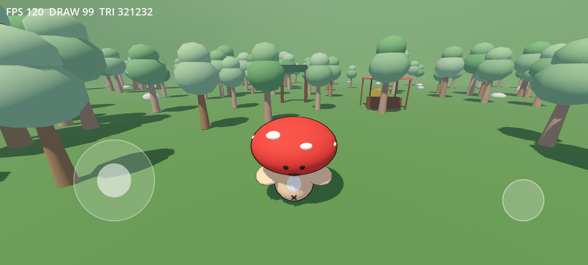
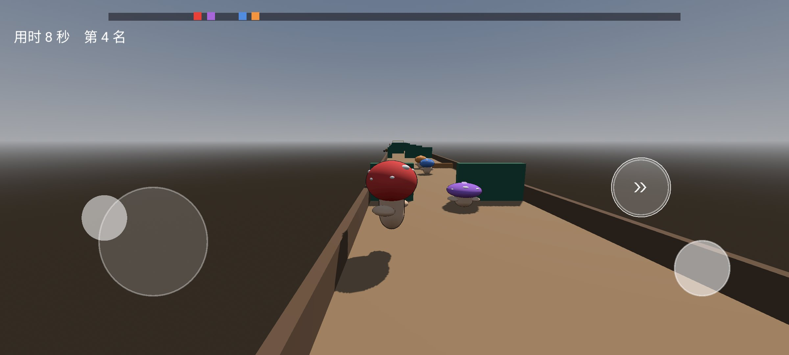

# 菌子派对（FungiParty）

一朵蘑菇在森林里过日子：去教室上「偷吃课」，跑一场障碍赛，围着一堆篝火玩烫手炸弹，站到树下接猫头鹰老师扔的糖，赢了攒蘑菇币去摊位换一顶新帽子。

## 截图

## 你会玩到什么

森林里有七个去处：校门、摊位、起跑线、蘑菇圈、猫头鹰树，再加饭店和帐篷。

一台手机能两个人玩：点右上角「＋ 加入」，第二朵蘑菇自己选角色和帽子，之后跟着你走；
进任何一处小游戏，两人同场——坐两张课桌、各抱一对投掷键、各占一个喂食位、赛跑分屏各跑一条道。

**上课偷吃大赛**

森林深处的校门通向一间教室。你坐在四张课桌中的一张，另外三个是同学，前面站着老师。

- 老师看黑板的时候，按住屏幕吃；他转过头来看你，马上松手装样子
- 被看到超过一下就罚站 3 秒，一局里被抓 3 次就出局
- 先吃满 20 口的人赢；时间到了就按口数结算
- 三个同学有各自的性格：胆小的先松手，胆大的总想多贪一口，偶尔就有人被拎起来罚站

**森林赛跑**

起跑线后面是一条 220 米直道，你和三个对手一起跑。

- 每 16~18 米一组障碍，墙上留一条缝：高墙只能绕，矮栏跳得过去
- 侧面会有动物冲出来横穿赛道（胖甲虫、推粪球的屎壳郎、丢松果的松鼠）。本体进场前 1 秒，赛道上先出现它的影子，影子从哪边来，它就打哪边来
- 跳：跨矮栏；冲刺：12 m/s 跑 0.3 秒，冷却 3 秒，按钮外圈转满才能再按
- 撞到东西会沿来向弹开一个身位、停 0.6 秒。全场只有这一种惩罚
- 名次换 70 / 50 / 35 / 20 蘑菇币，每撞一次扣 5
- 每局地形都是新掷的种子：障碍的位置和类型、动物的出场时刻，局局不一样

**烫手炸弹**

蘑菇圈里有一堆篝火，四个菌子围坐一圈传一颗炸弹。

- 引信看不见，只能看火花：橙色稳燃、冒白星、整颗发白；听见滴答越来越急就得撒手
- 拿在手上可以往左扔，也可以往右扔，只能传给相邻还活着的人
- 炸弹在谁手里炸谁死；**扔出去半路炸，算扔的人死**——拖到最后一刻再甩是一场拿命换的赌
- 收到炸弹有 0.3 秒站稳，这期间按了不算但会记住，站稳一结束自动扔出去
- 三个对手有各自的性格：蓝的常扔早了，红的赌到白热才撒手，紫的记仇，谁扔给他他就扔回谁
- 炸死一个重新点燃，最后活下来的赢；名次换 70 / 50 / 35 / 20 蘑菇币，第四个也有 20

**猫头鹰喂食**

森林边上一棵歪脖子大树，猫头鹰老师蹲在枝头往下扔东西：糖果，和屎。

- 四朵蘑菇并排站在树下，背对着你、仰头看着鸟，嘴开在头顶上
- 长按屏幕张嘴，松手闭嘴。东西落到嘴边那一下嘴张着就算吃到：糖 +1 分，屎当场出局（本关剩下那段 2.5 倍速放完，分数停在这里）
- 三关 45 / 50 / 55 秒，一关比一关快、屎一关比一关多，投喂还时不时来一串连珠，数不出拍子
- 三个对手性格不同：稳的照常吃，贪的连屎都敢吃（所以常出局），胆小的见屎就缩（所以常漏糖）
- 三关打完按总分排名，换 70 / 50 / 35 / 20 蘑菇币

**课堂之外的摊位**

一局结束，吃到的口数、跑出的名次，都会换成蘑菇币。攒够了去森林里的小摊，摊主卖一顶蓝莓帽。买下之后你的蘑菇会立刻变蓝，教室里坐着的那个也一样；想换回原来的红帽子，摊位上点一下就行。

**一天、饭店、帐篷**

- 每天有 100 点体力，玩一局扣 12（教室）/ 20（赛跑）/ 25（炸弹）/ 30（喂食）——走路、闲逛永远不扣
- 天色就是体力：满体力是清晨，体力见底太阳压到山后，天就黑了。吃完一顿回体力，太阳也不会倒回上午
- 摊位旁边的饭店：20 币一份，回 25 体力，一天三份；体力见底之后饭店打烊，只剩回家睡觉
- 再往边上是一顶帐篷，走进去点「睡到早上」就过夜：天一亮体力回满，今天重新算
- 攒够币去摊位抽帽子（单抽 50、十连 450，抽重复的按档位退币），穿哪顶在帐篷里换——摊位只管抽

抬头能看见天：太阳戴墨镜从东边升起来，晚上月亮戴着睡帽出来值夜。

## 操作

- 手机：单指。左下角摇杆走路，右下角圆按钮跳，它上面那个圆按钮冲刺；进教室后只要按住与松手
- 双人时每人占屏幕一半：自己那半边的摇杆和按钮归自己，「按住吃 / 按住张嘴」也按左右半屏分；森林里谁推摇杆谁带队，另一个人跟在他身后
- 电脑：WASD 走路、空格跳、Shift 冲刺；进教室后按住空格吃东西
- 返回键：赛跑和烫手炸弹里弹暂停面板（重新开始 / 回森林 / 退出游戏，再按一次继续）；森林和教室里直接退出
- 帐篷 / 饭店：走到跟前自动弹浮层；帐篷里能睡觉、换角色和帽子（双人时先选「你」还是「2P」）

## 说明

- 版本 0.10.0，安卓横屏，单机离线，不联网、不收集任何数据
- 存档只在手机本地，记着蘑菇币、你有哪顶帽子、今天还剩多少体力和一天过到哪儿了
- 给自己和朋友玩的小作品，不上架商店

## License

[MIT](LICENSE)
